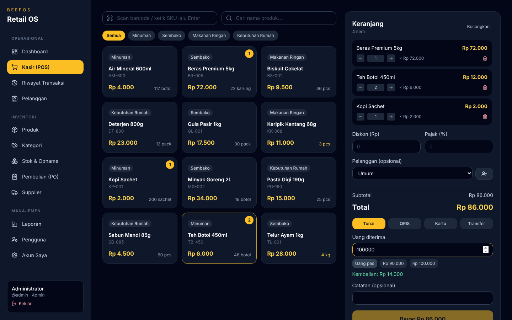
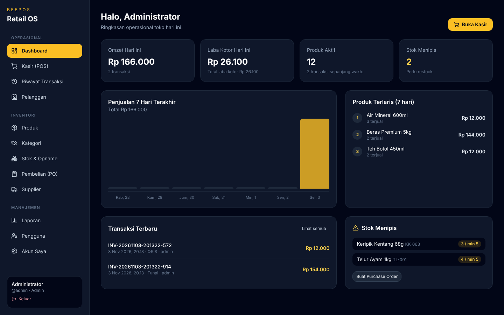
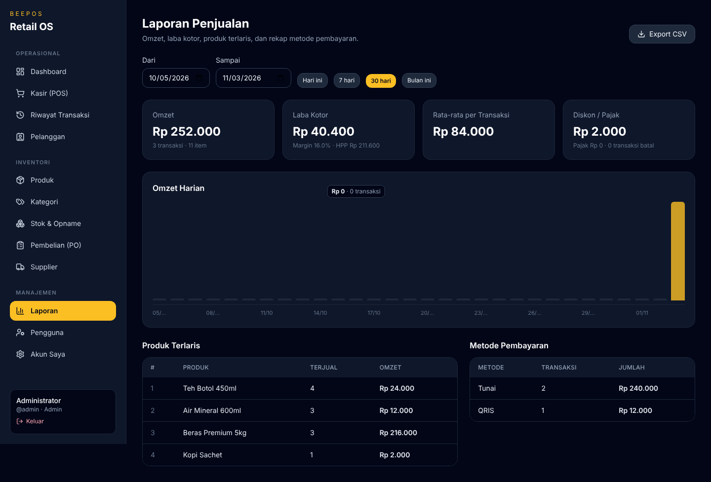
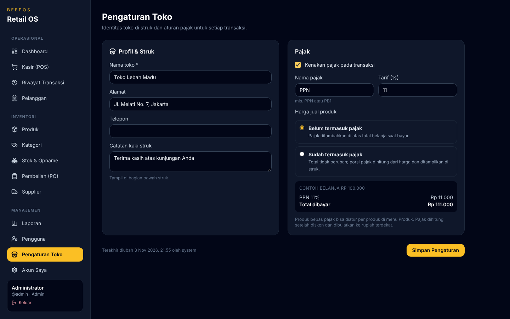
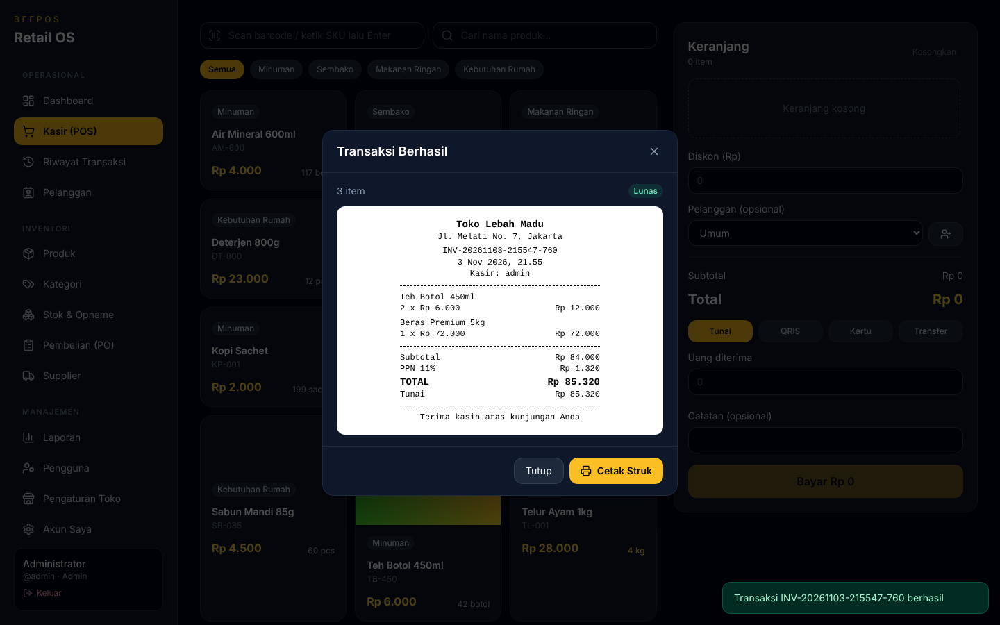
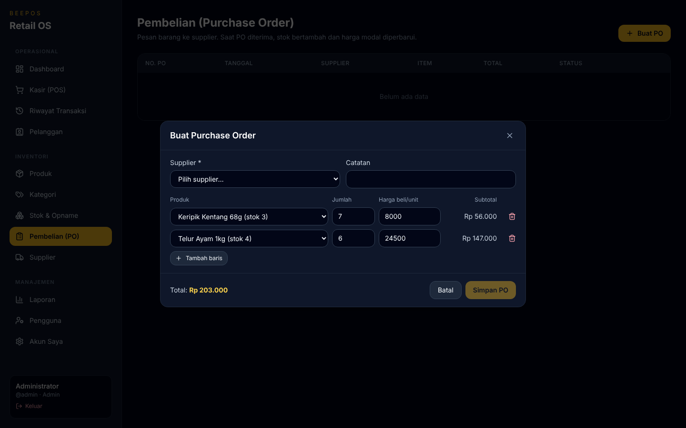

# BeePos-App

BeePos-App adalah aplikasi Point of Sale (POS) untuk retail dan UMKM: kasir cepat dengan barcode, manajemen stok yang teraudit, purchase order ke supplier, laporan penjualan & laba kotor, serta hak akses per peran.



## Fitur

**Kasir (POS)**
- Scan barcode / ketik SKU, pencarian produk, filter kategori
- Keranjang dengan ubah jumlah, diskon nominal, pilih pelanggan (bisa tambah pelanggan baru langsung)
- **Pajak otomatis** (mis. PPN 11%) sesuai Pengaturan Toko: harga belum/sudah termasuk pajak, produk bebas pajak, dihitung setelah diskon dan dibulatkan ke rupiah — dihitung ulang di server, tidak bisa diubah dari kasir
- Pembayaran Tunai (uang diterima, tombol uang pas, kembalian), QRIS, Kartu, Transfer
- Struk siap cetak (printer thermal 80 mm) dengan nama, alamat, telepon, dan catatan kaki toko dari Pengaturan Toko
- Validasi stok di server (dengan row lock) sehingga stok tidak bisa minus walau dua kasir bertransaksi bersamaan

**Transaksi**
- Riwayat transaksi per rentang tanggal, cari invoice/pelanggan/kasir, cetak ulang struk
- Pembatalan (void) transaksi oleh manajer/admin dengan alasan — stok otomatis dikembalikan

**Inventori**
- Produk: **gambar produk** (JPG/PNG/WebP ≤ 2 MB, tampil di kasir), SKU unik, barcode, kategori, satuan, harga jual, harga modal, margin, stok minimum, kena/bebas pajak, nonaktifkan (soft delete)
- Kategori (ganti nama kategori ikut memperbarui produk)
- Stok masuk, stok keluar, dan **stock opname**; setiap perubahan stok tercatat (jenis, jumlah, stok akhir, catatan, oleh siapa)
- Purchase order ke supplier: buat (otomatis terisi produk yang stoknya menipis), terima barang (stok bertambah + harga modal diperbarui), batalkan
- Supplier dan pelanggan

**Dashboard & Laporan**
- Omzet & laba kotor hari ini, grafik 7 hari, produk terlaris, stok menipis, transaksi terbaru
- Laporan penjualan per periode: omzet, pajak terkumpul, penjualan bersih, HPP, laba kotor (tanpa pajak), margin, rata-rata transaksi, diskon/pajak, omzet harian, produk terlaris, rekap metode pembayaran
- Export CSV (bisa dibuka di Excel)

**Pengguna & Keamanan**
- Login JWT, ganti password sendiri
- Peran: **Admin** (semua fitur + kelola pengguna), **Manajer** (produk, stok, PO, supplier, laporan, void), **Kasir** (kasir, riwayat, pelanggan). Kasir tidak menerima data HPP/laba dari API.
- Pengguna dinonaktifkan (bukan dihapus) agar riwayat transaksi tetap utuh; sistem mencegah admin terakhir dinonaktifkan

## Stack
- Frontend: React 18 + Vite + TypeScript + Tailwind CSS
- Backend: Java 21, Spring Boot 3.3, Spring Security (JWT), Spring Data JPA
- Database: PostgreSQL 16
- Infra: Docker Compose (Nginx menyajikan frontend dan mem-proxy `/api` ke backend), GitHub Actions CI

## Menjalankan lokal (development)

```bash
# 1. Database
docker compose up -d postgres

# 2. Backend (port 8080) — data demo otomatis dibuat saat pertama jalan
cd backend
./mvnw spring-boot:run

# 3. Frontend (port 5173)
cd frontend
cp .env.example .env   # opsional
npm install
npm run dev
```

Buka http://localhost:5173.

| Akun | Password | Peran |
|------|----------|-------|
| `admin` | `admin123` | Admin |
| `manager` | `manager123` | Manajer (data demo) |
| `kasir` | `kasir123` | Kasir (data demo) |

Dokumentasi API (Swagger UI): http://localhost:8080/swagger-ui.html

## Menjalankan dengan Docker (semua service)

```bash
cp .env.example .env    # ganti password & JWT_SECRET
docker compose up -d --build
```

Aplikasi tersedia di http://localhost:8081 (frontend + API via Nginx). Lihat [docs/deployment-vps.md](docs/deployment-vps.md) untuk deploy ke VPS.

## Konfigurasi backend (environment variable)

| Variabel | Default | Keterangan |
|----------|---------|------------|
| `SPRING_DATASOURCE_URL` / `_USERNAME` / `_PASSWORD` | lokal | Koneksi PostgreSQL |
| `JWT_SECRET` | dev secret | Minimal 32 byte, **wajib diganti** di production |
| `JWT_EXPIRATION_MS` | `86400000` | Masa berlaku token (24 jam) |
| `APP_ADMIN_PASSWORD` | `admin123` | Password akun `admin` saat pertama kali dibuat |
| `APP_SEED_DEMO` | `true` | Buat data demo (produk, user manager/kasir). Set `false` di production |
| `APP_UPLOAD_DIR` | `./uploads` | Folder penyimpanan gambar produk (Docker: volume `uploads_data`) |
| `APP_STORE_NAME` / `APP_STORE_ADDRESS` | `BeePos Store` | Nilai awal Pengaturan Toko (selanjutnya diubah di aplikasi) |
| `APP_TIMEZONE` | `Asia/Jakarta` | Zona waktu untuk "hari ini" dan laporan harian |
| `APP_CORS_ALLOWED_ORIGINS` | localhost | Origin frontend (pisahkan dengan koma) |

Frontend: `VITE_API_URL`, `VITE_STORE_NAME`, `VITE_STORE_ADDRESS`.

## Testing

```bash
cd backend && ./mvnw test        # integration test (H2) untuk alur POS, RBAC, PO, stok, laporan
cd frontend && npm run build     # typecheck + build
```

## Ringkasan API

| Method | Endpoint | Akses |
|--------|----------|-------|
| POST | `/api/auth/login` | publik |
| GET | `/api/auth/me`, POST `/api/auth/change-password` | login |
| GET | `/api/dashboard/summary` | semua peran |
| GET/POST/PUT/DELETE | `/api/products` (+ `/code/{barcodeAtauSku}`) | baca: semua · tulis: admin/manajer |
| GET/POST/PUT/DELETE | `/api/categories` | baca: semua · tulis: admin/manajer |
| GET/POST/PUT | `/api/customers` (DELETE: admin/manajer) | semua peran |
| CRUD | `/api/suppliers` | admin/manajer |
| GET, POST `/in` `/out` `/adjust` | `/api/inventory` | admin/manajer |
| GET/POST, POST `/{id}/receive` `/{id}/cancel` | `/api/purchases` | admin/manajer |
| GET (`?from&to`), GET `/{id}`, POST | `/api/sales` | semua peran |
| POST | `/api/sales/{id}/void` | admin/manajer |
| GET | `/api/reports/sales`, `/api/reports/sales.csv` | admin/manajer |
| CRUD | `/api/users` | admin |
| GET / PUT | `/api/settings` | baca: semua · ubah: admin |
| POST / DELETE | `/api/products/{id}/image` (multipart `file`) | admin/manajer |
| GET | `/api/products/{id}/image` | publik (dipakai tag ``) |

## Screenshot

| Dashboard | Laporan |
|-----------|---------|
|  |  |
| **Pengaturan Toko & Pajak** | |
|  | |
| **Struk** | **Purchase Order** |
|  |  |

## Status
- [x] Backend Spring Boot + JWT + role-based access
- [x] Master data: produk, kategori, pelanggan, supplier, pengguna
- [x] Transaksi POS, void, struk, stok otomatis
- [x] Stok masuk/keluar, stock opname, riwayat pergerakan stok
- [x] Purchase order (buat, terima, batal)
- [x] Dashboard & laporan penjualan + export CSV
- [x] Frontend terintegrasi penuh ke API, responsif untuk mobile
- [x] Docker production (Nginx) + GitHub Actions CI
- [ ] Migrasi skema dengan Flyway (saat ini `ddl-auto: update`)
- [ ] Multi-outlet / multi-gudang
